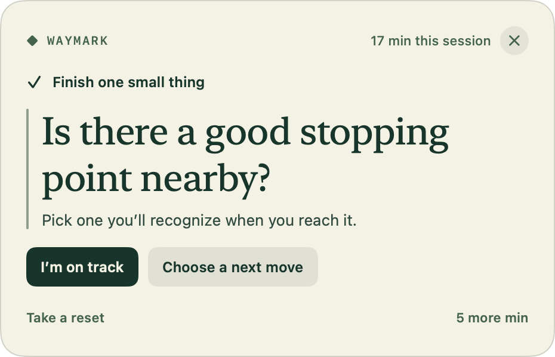

# Waymark

Waymark is a macOS menu-bar app for catching yourself mid-scroll. After a sustained session, a check-in lets you name what you want to do next, take a short reset, or choose to stay.



## How it works

- Ordinary check-ins start after 10 minutes of continuous use, including scrolling. Frequent typing or clicking lengthens the interval.
- The 104-prompt deck has four layouts. If you’re scrolling when a reminder appears, it uses the blunt coach cards, which can include explicit language.
- Some cards offer a 60-second experiment or a 30-second reset. Finishing or snoozing a fresh prompt asks you to put your next action into a few words.
- The signpost menu has previews, a one-hour pause, and optional launch at login.

Waymark uses recent input timing and a macOS display-awake signal to pace reminders. It runs locally and has no telemetry. Reflection text is discarded when its card closes.

## Run the preview

[Download the Waymark preview](../../releases/tag/v0.1.3)

The prebuilt preview targets Apple silicon Macs with macOS 14 or later. Unzip the release asset, open `Waymark.app`, then choose **Preview a check-in** from the menu-bar signpost.

This first build is ad-hoc signed and lacks Apple notarization. If macOS blocks the downloaded app, you can build from the source below. [How macOS verifies downloaded apps](https://support.apple.com/en-us/102445)

## Build from source

With Swift 6 or later and Apple developer tools, run these commands from the source directory.

```sh
./Scripts/bundle.sh
open .build/Waymark.app
```

Run `swift test --disable-xctest` for the core suite. [Implementation plan](PLAN.md) · [Release history](UPDATES.md)
